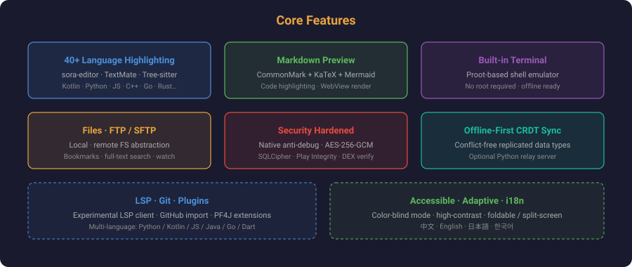
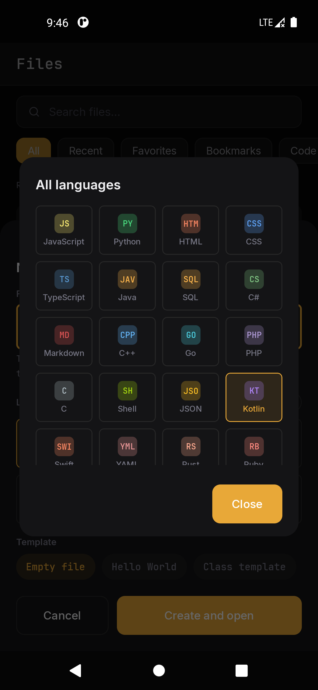
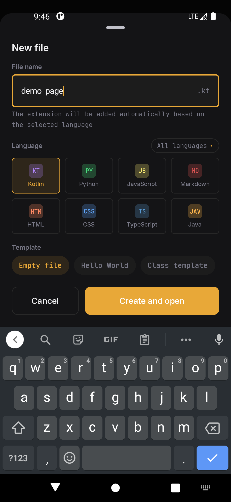
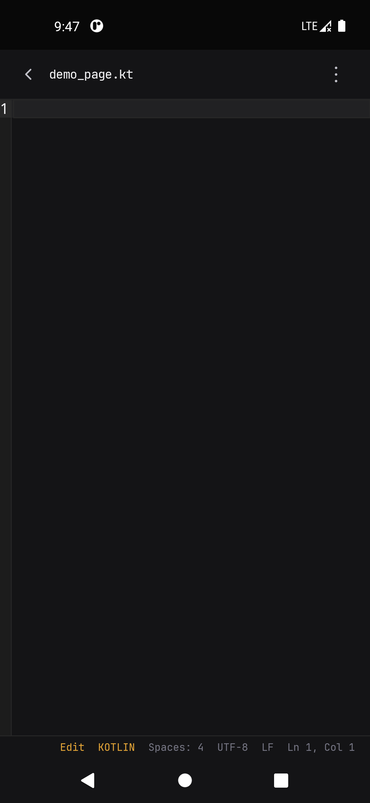
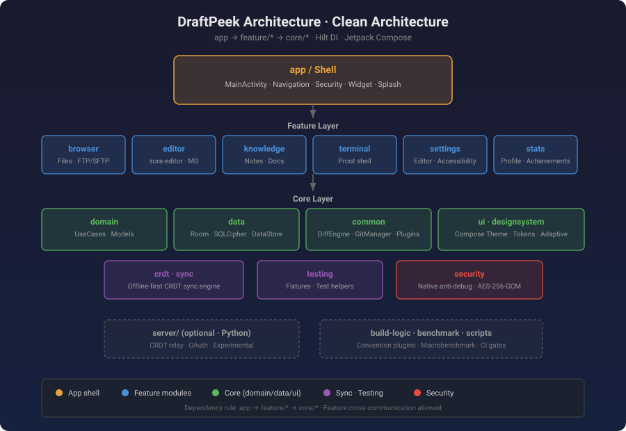

# DraftPeek · 撰码轻览

[](LICENSE)
[](https://github.com/ReSerendipity/DraftPeek/actions/workflows/android.yml)
[](https://github.com/ReSerendipity/DraftPeek/releases/latest)


[](CONTRIBUTING.md)
[](https://github.com/ReSerendipity/.github/tree/main/governance)

> [中文](#中文) · [English](#english)

Android 原生代码 / 文本编辑器：内置终端、Markdown 预览、40+ 语言语法高亮。Jetpack Compose + 整洁架构，安全加固、离线可用。

A native Android code & text editor with a built-in terminal, Markdown preview, and syntax highlighting for 40+ languages. Jetpack Compose + clean architecture; hardened, offline-first.

---

## 中文

### 项目简介

**DraftPeek（撰码轻览）** 是一款面向 Android 的原生代码与文本编辑器，定位为"口袋里的开发工作台"。它将文件浏览、多语言编辑、Markdown 预览、集成终端与远程文件访问整合在一个离线优先的应用中，无需 root 即可使用。

### 核心特性



- **多语言语法高亮** — 基于 sora-editor（TextMate + Tree-sitter），支持 Kotlin、Python、JavaScript、C++、Go、Rust、Markdown 等 40+ 语言
- **Markdown 编辑与预览** — CommonMark 原生解析 + WebView 渲染管线，支持 KaTeX 数学公式、Mermaid 图表与代码高亮
- **集成终端** — 基于 Proot 架构的终端模拟器，无需设备 root（rootfs 未随包分发，详见 [THIRD_PARTY_NOTICES](docs/THIRD_PARTY_NOTICES.md)）
- **文件浏览** — 本地 / FTP / SFTP 文件系统抽象，支持目录监听、书签、全文搜索
- **安全加固** — Native C 反调试 + Play Integrity + APK/DEX 校验 + AES-256-GCM 文件加密，数据库层 SQLCipher 加密
- **离线优先同步** — CRDT（无冲突复制数据类型）引擎，可选配 Python 中继服务（`server/`，实验性）
- **多标签编辑** — 同时打开多个文件，快速切换
- **实验性 LSP** — 多语言 Language Server Protocol 客户端（Python / Kotlin / JS / Java / Go / Dart）
- **Git 与插件** — GitHub 仓库导入；PF4J 插件系统
- **可访问性** — 色盲模式、高对比度主题、折叠屏 / 分屏自适应
- **国际化** — 中文（默认）、English、日本語、한국어

### 界面展示

**文件浏览器主界面** — 本地文件列表、搜索、最近 / 收藏 / 书签 / 代码分类标签页，支持新建文件并选择语言模板：



**新建文件对话框** — 文件名输入、语言卡片选择（Kotlin / Python / JS / Markdown 等）、Empty file / Hello World / Class template 模板：



**编辑界面** — sora-editor 代码编辑区、行号、底部状态栏（语言、缩进、编码、换行符、行列位置）：



**分层架构** — app 壳 → feature 功能模块 → core 基础层（domain / data / ui / sync / security）：



### 快速开始

**环境要求**

| 依赖 | 版本 |
|---|---|
| JDK | 17 |
| Android Studio | Meerkat 2024.3.2+（或任意支持 AGP 8.10.1 的版本） |
| Android SDK | compileSdk 36, targetSdk 36, minSdk 26（Android 8.0+） |
| Gradle | 8.14.3（wrapper 管理，无需手动安装） |
| 支持 ABI | arm64-v8a · armeabi-v7a · x86_64 |

**构建 Debug APK**

```bash
git clone https://github.com/ReSerendipity/DraftPeek.git
cd DraftPeek
./gradlew assembleDebug
# 产物：app/build/outputs/apk/debug/app-debug.apk
```

**从 Release 安装**

前往 [Releases](https://github.com/ReSerendipity/DraftPeek/releases/latest) 下载 `app-production-release.apk`，开启手机"未知来源安装"后直接安装。

**最小验证**

安装后打开应用 → 在 Files 标签页新建一个 `.kt` 或 `.md` 文件 → 确认编辑器与语法高亮正常加载。

### 系统要求与兼容性

- Android 8.0（API 26）及以上
- 支持 arm64-v8a、armeabi-v7a、x86_64 架构
- 无需 root；终端功能依赖 Proot（rootfs 需另行获取）
- 无 Google Play 服务环境亦可运行核心编辑功能

### 使用示例

1. **编辑 Kotlin 文件** — New file → 选择 Kotlin → 输入代码，语法高亮与缩进自动生效
2. **写 Markdown 笔记** — 新建 `.md` 文件，切换预览视图查看 KaTeX / Mermaid 渲染
3. **连接 SFTP 远程目录** — Settings → Remote → 添加 SFTP 主机，浏览远程代码库
4. **多标签对照** — 打开两个文件，顶部分标签切换，Diff 视图并排对比

### FAQ

**Q: 终端里为什么没有常用命令？**
A: Proot rootfs 未随 APK 分发（体积与许可原因）。请参考 [THIRD_PARTY_NOTICES](docs/THIRD_PARTY_NOTICES.md) 获取合规 rootfs 镜像。

**Q: 数据存在哪里？会上传到云端吗？**
A: 所有文件默认仅保存在本机应用沙盒；SQLCipher 加密数据库存储设置与书签。CRDT 同步为可选功能，不开启则完全离线。

**Q: 支持折叠屏 / 平板吗？**
A: 支持。UI 使用 WindowSizeClass 自适应布局，分屏与展开态自动调整列数与面板比例。

**Q: 如何贡献代码？**
A: Fork → 新建分支 → 提交（需 DCO 签名，`git commit -s`）→ 发 PR。规范见 [组织贡献指南](https://github.com/ReSerendipity/.github/blob/main/CONTRIBUTING.md)。

**Q: 发现安全漏洞怎么报告？**
A: 请勿公开 issue。通过 [SECURITY.md](.github/SECURITY.md) 的私密披露渠道报告。

### 文档与治理

- [版本与发布治理](docs/release-governance.md) — 远端优先、tag 驱动、产物可校验
- [发布检查清单](docs/RELEASE_CHECKLIST.md)
- [编码规范](docs/CODING_STANDARDS.md)
- [更新日志](CHANGELOG.md)
- [隐私政策](docs/PRIVACY_POLICY.md) · [用户协议](docs/USER_AGREEMENT.md)

本仓库遵循 [ReSerendipity 组织治理规范](https://github.com/ReSerendipity/.github/tree/main/governance)。

### 贡献、安全与支持

- 贡献流程：[CONTRIBUTING.md](https://github.com/ReSerendipity/.github/blob/main/CONTRIBUTING.md)（Conventional Commits + DCO）
- 安全披露：[.github/SECURITY.md](.github/SECURITY.md)
- Bug 与功能请求：[GitHub Issues](https://github.com/ReSerendipity/DraftPeek/issues)

### 许可证

本项目以 **Apache License 2.0** 开源发布（Copyright 2026 ReSerendipity）。详见 [LICENSE](LICENSE) · [NOTICE](NOTICE) · [THIRD_PARTY_NOTICES](docs/THIRD_PARTY_NOTICES.md)。

---

## English

### Overview

**DraftPeek** is a native Android code and text editor built as a "pocket dev workstation." It integrates file browsing, multi-language editing, Markdown preview, an integrated terminal, and remote file access into one offline-first app — no device root required.

### Key Features

- **40+ language highlighting** — sora-editor (TextMate + Tree-sitter): Kotlin, Python, JavaScript, C++, Go, Rust, Markdown, and more
- **Markdown editing & preview** — CommonMark parser + WebView render pipeline with KaTeX, Mermaid, and code highlighting
- **Built-in terminal** — Proot-based shell emulator, no device root needed (rootfs not bundled; see [THIRD_PARTY_NOTICES](docs/THIRD_PARTY_NOTICES.md))
- **Files: local / FTP / SFTP** — filesystem abstraction, directory watch, bookmarks, full-text search
- **Security hardened** — Native anti-debug, Play Integrity, APK/DEX verification, AES-256-GCM encryption, SQLCipher database
- **Offline-first CRDT sync** — conflict-free replicated data types; optional Python relay server (`server/`, experimental)
- **Multi-tab editing** — open multiple files and switch instantly
- **Experimental LSP** — language server client for Python / Kotlin / JS / Java / Go / Dart
- **Git & plugins** — GitHub repo import; PF4J extension system
- **Accessible & adaptive** — color-blind mode, high-contrast theme, foldable / split-screen layouts
- **i18n** — Chinese (default), English, 日本語, 한국어

### Screenshots

**Main file browser** — local file list, search, and tabs for All / Recent / Favorites / Bookmarks / Code; new-file dialog with language templates:


**New file dialog** — filename input, language cards (Kotlin / Python / JS / Markdown …), Empty file / Hello World / Class template presets:


**Editor screen** — sora-editor editing surface, line numbers, status bar (language, indent, encoding, EOL, cursor position):


**Layered architecture** — app shell → feature modules → core layer (domain / data / ui / sync / security):


### Quick Start

**Requirements**

| Dependency | Version |
|---|---|
| JDK | 17 |
| Android Studio | Meerkat 2024.3.2+ (or any IDE supporting AGP 8.10.1) |
| Android SDK | compileSdk 36, targetSdk 36, minSdk 26 (Android 8.0+) |
| Gradle | 8.14.3 (via wrapper) |
| ABIs | arm64-v8a · armeabi-v7a · x86_64 |

**Build debug APK**

```bash
git clone https://github.com/ReSerendipity/DraftPeek.git
cd DraftPeek
./gradlew assembleDebug
# Output: app/build/outputs/apk/debug/app-debug.apk
```

**Install from Release**

Download `app-production-release.apk` from the [latest release](https://github.com/ReSerendipity/DraftPeek/releases/latest), enable "install from unknown sources," and install.

**Smoke test**

Open the app → create a `.kt` or `.md` file in the Files tab → confirm the editor and syntax highlighting render.

### Compatibility

- Android 8.0 (API 26) and above
- arm64-v8a, armeabi-v7a, x86_64
- No root required; the terminal needs a separately obtained Proot rootfs image
- Core editing works without Google Play Services

### Examples

1. **Edit Kotlin** — New file → Kotlin → type code; highlighting and indentation apply automatically
2. **Write Markdown notes** — create a `.md` file, toggle preview to see KaTeX / Mermaid rendering
3. **SFTP remote** — Settings → Remote → add an SFTP host, browse remote repos
4. **Multi-tab diff** — open two files, switch via top tabs, compare side by side

### FAQ

**Q: Why are common commands missing in the terminal?**
A: The Proot rootfs is not bundled with the APK (size and licensing). See [THIRD_PARTY_NOTICES](docs/THIRD_PARTY_NOTICES.md) for how to obtain a compliant rootfs image.

**Q: Where is my data stored? Is it uploaded?**
A: Files live only in the app sandbox by default; settings and bookmarks are stored in an SQLCipher-encrypted database. CRDT sync is opt-in — without enabling it, the app is fully offline.

**Q: Does it support foldables / tablets?**
A: Yes. The UI uses WindowSizeClass adaptive layouts and adjusts columns and panel ratios for split-screen and expanded states.

**Q: How do I contribute?**
A: Fork → feature branch → commit with DCO sign-off (`git commit -s`) → open a PR. See the [org contributing guide](https://github.com/ReSerendipity/.github/blob/main/CONTRIBUTING.md).

**Q: How do I report a security vulnerability?**
A: Do not open a public issue. Use the private disclosure channel in [SECURITY.md](.github/SECURITY.md).

### Documentation & Governance

- [Release governance](docs/release-governance.md) — trunk-based, tag-driven, verifiable artifacts
- [Release checklist](docs/RELEASE_CHECKLIST.md)
- [Coding standards](docs/CODING_STANDARDS.md)
- [Changelog](CHANGELOG.md)
- [Privacy policy](docs/PRIVACY_POLICY.md) · [Terms](docs/USER_AGREEMENT.md)

This repo follows the [ReSerendipity org governance](https://github.com/ReSerendipity/.github/tree/main/governance).

### Contributing, Security & Support

- Contributing: [CONTRIBUTING.md](https://github.com/ReSerendipity/.github/blob/main/CONTRIBUTING.md) (Conventional Commits + DCO)
- Security disclosure: [.github/SECURITY.md](.github/SECURITY.md)
- Bugs & feature requests: [GitHub Issues](https://github.com/ReSerendipity/DraftPeek/issues)

### License

Released under the **Apache License 2.0** (Copyright 2026 ReSerendipity). See [LICENSE](LICENSE) · [NOTICE](NOTICE) · [THIRD_PARTY_NOTICES](docs/THIRD_PARTY_NOTICES.md).
